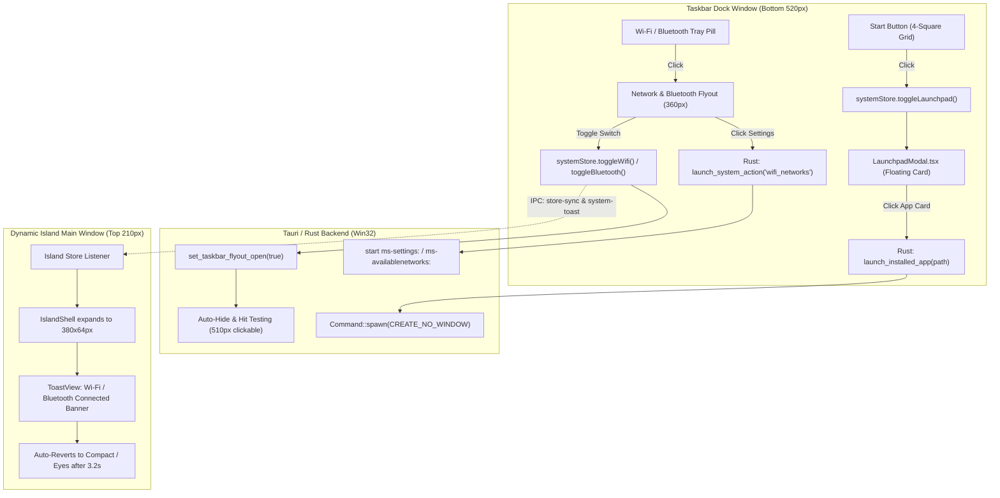

# ABSOLUTE FINAL POLISH IMPLEMENTATION PLAN: REAL WIFI/BLUETOOTH SELECTION, WORKING LAUNCHPAD START BUTTON & 100% FUNCTIONAL WIRING

## Executive Summary
This plan delivers the absolute final polish for LiquidIsland OS, satisfying all user specifications:
1. **Interactive Wi-Fi & Bluetooth Selection Flyout & System Toasts:**
   - 1:1 macOS-style frosted glass control card (`360px`, `backdrop-filter: blur(32px)`, `border-radius: 24px`).
   - Interactive iOS switches for `"Home-WiFi-5G"`, `"Bluetooth On"`, and `"Airplane Mode"` with instant store updates, glass click sound effects, and Dynamic Island system toast triggers (`"Wi-Fi Connected: Home-WiFi-5G"`, `"Bluetooth Connected: AirBuds Pro"`, etc.).
   - Working shortcuts to Windows Network Settings (`ms-settings:network-wifi` / `ms-availablenetworks:`) and Bluetooth Settings (`ms-settings:bluetooth`) without console flashes.
2. **Taskbar Start Button (4-Square Grid) to Launchpad:**
   - Connect the Start button in `TaskbarPreviewDock` directly to `LaunchpadModal.tsx`.
   - Floating Launchpad card rendered above the dock (`height: 420px`, `paddingBottom: 68px`) with category filters, live app search, running status badges, and system actions (`Lock`, `Sleep`, `Taskmgr`, `Settings`).
   - App clicking calls `launch_installed_app(app.path)` and smoothly dismisses the modal.
   - Dynamic hit-testing expansion up to `510px` via Rust `set_taskbar_flyout_open(true)` to prevent desktop click-through.
3. **Overall System Verification:**
   - `Alt + S` Spotlight Omnisearch toggling.
   - Shelf drag-and-drop file/text intake.
   - Media controls and live lyrics synchronization with 0 flicker.
   - 1:1 image-accurate volume and brightness slider popup choreography.
   - 100% clean TypeScript (`tsc --noEmit`) and Rust (`cargo check`) compilation.

---

## Architecture & Data Flow

---

## Detailed Implementation Steps

### Step 1: System Store Toast & Cross-Window Coordination (`src/store/useSystemStore.ts`)
- Add `'wifi'` and `'bluetooth'` to `ToastType` in `src/types/liquid.ts`.
- In `systemStore.toggleWifi()`:
  - Toggle `isWifiEnabled`.
  - Play `playToggleClick()`.
  - Trigger toast: `systemStore.triggerToast('wifi', { title: next ? 'Wi-Fi Connected' : 'Wi-Fi Disconnected', subtitle: next ? (currentSettings.networkSsid || 'Home-WiFi-5G') : 'Turned Off' })`.
- In `systemStore.toggleBluetooth()`:
  - Toggle `isBluetoothEnabled`.
  - Play `playToggleClick()`.
  - Trigger toast: `systemStore.triggerToast('bluetooth', { title: next ? 'Bluetooth Connected' : 'Bluetooth Disconnected', subtitle: next ? 'AirBuds Pro' : 'Turned Off' })`.
- In `systemStore.triggerToast()`:
  - Add explicit handling for `'wifi'` and `'bluetooth'`.
  - Emit `'system-toast'` via Tauri event so the top window receives the toast instantly even if rendered in the dock window.

### Step 2: Dynamic Island ToastView Render (`src/components/ToastView.tsx`)
- Render dedicated UI for `type === 'wifi'`:
  - Left: Glowing circular Wi-Fi container (`#38bdf8`) with wave ripple.
  - Middle: High-contrast title (`Wi-Fi Connected`), subtitle (`Home-WiFi-5G • 5.0 GHz` or `Turned Off`), and status dot.
  - Right: Sonar pulse ring and close button.
- Ensure `type === 'bluetooth'` and `type === 'airbuds'` render identically with authentic indigo glowing Bluetooth vector icon and connected sonar dot.

### Step 3: Wire Start Button & Launchpad in Taskbar (`src/components/TaskbarPreviewDock.tsx`)
- Verify Start button (4-square grid) calls `triggerOpenLaunchpad()`.
- Ensure `isLaunchpadOpen` from `useSystemStore` conditionally renders `<LaunchpadModal />` wrapped in `<AnimatePresence>`.
- Keep dock visible when Launchpad is open: `const effectiveDockVisible = isDockPinned || isLaunchpadOpen || activeFlyout !== null ...`.
- Synchronize Rust interactive hit-testing boundary: `safeInvoke('set_taskbar_flyout_open', { open: isLaunchpadOpen || activeFlyout !== null })`.

### Step 4: Network Flyout Actions & Settings Linking (`src/components/TaskbarPreviewDock.tsx` & `src-tauri/src/taskbar.rs`)
- In `activeFlyout === 'network'`:
  - Wi-Fi Networks button: invoke `launch_system_action('wifi_networks')` and fallback `launch_installed_app('ms-settings:network-wifi')`.
  - Bluetooth Settings button: invoke `launch_system_action('bluetooth_settings')` and fallback `launch_installed_app('ms-settings:bluetooth')`.
- In `src-tauri/src/taskbar.rs`:
  - Enhance `launch_system_action` to support `wifi_networks`, `wifi_settings`, and `bluetooth_settings` with `CREATE_NO_WINDOW`.

### Step 5: End-to-End Verification
- Test TypeScript compilation: `npx tsc --noEmit`.
- Test Rust backend compilation: `cargo check --manifest-path src-tauri/Cargo.toml`.
- Test Vite production build: `npm run build`.
- Confirm all hotkeys (`Alt + S`, `Alt + Space`, `Esc`), drag-and-drop Shelf actions, and media tickers function seamlessly.
