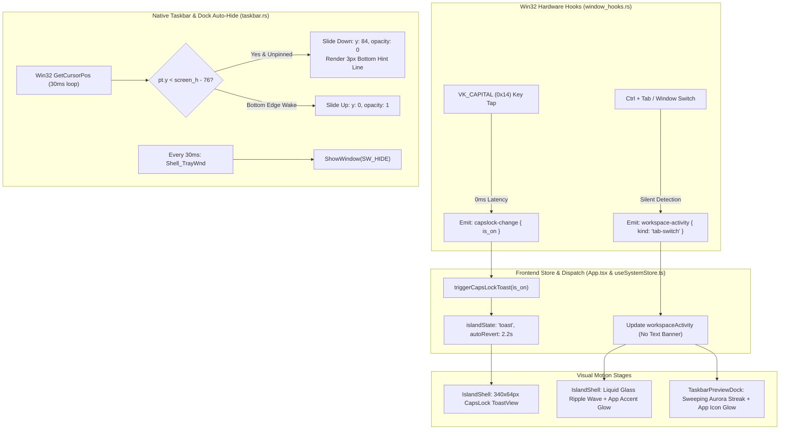

# ABSOLUTE FINAL POLISH PLAN: SILENT TAB-SWITCH, CAPSLOCK LIQUID TOAST & BULLETPROOF AUTO-HIDE (40 MB RAM TIER)

## 1. ARCHITECTURE & OBJECTIVES
This absolute final plan locks in all visual and functional requirements under the high-fluidity 40.0 MB RAM ceiling:

1. **Instant CapsLock State Popup Toast (`window_hooks.rs`, `App.tsx`, `useSystemStore.ts`, `ToastView.tsx`):**
   - Win32 fast 25ms polling loop in `window_hooks.rs` intercepts `VK_CAPITAL` (`0x14`).
   - Detects the exact millisecond of the hardware keypress via `is_key_down(VK_CAPITAL as i32)` and state reconciliation via `GetKeyState(VK_CAPITAL as i32)`.
   - Emits `"capslock-change"` with payload `{ is_on: bool }`.
   - Renders a dedicated Apple-style obsidian pill card in `ToastView.tsx` (`340px × 64px`, border-radius `32px`):
     - **Left Slot:** Custom illuminated key-cap SVG with uppercase indicator (`🔠` / `🔒`), glowing neon cyan (`#38bdf8`) when ON, or obsidian slate (`#94a3b8`) when OFF.
     - **Center Slot:** `"Caps Lock On"` / `"Caps Lock Off"` with subtext `"Uppercase letters enabled"` / `"Standard lowercase typing"`.
     - **Right Slot:** Active status indicator pill (`CAPS` / `OFF`) with glowing status LED dot + `playGlassPop()` SFX, auto-dismissing cleanly after `2.2s`.

2. **Purely Visual Tab-Switch Animation — Zero Text Pop-ups (`WorkspaceSwitcherOverlay.tsx`, `IslandShell.tsx`, `TaskbarPreviewDock.tsx`):**
   - Absolutely zero floating text cards, badges, or title banners rendered on tab switch.
   - **Top Dynamic Island (`IslandShell.tsx`):** High-fluidity Liquid Glass Ripple Wave (`.liquid-ripple-wave`) traveling horizontally across the obsidian notch body + glowing pulsing color aura (`box-shadow`) matching the active app's `accent_color`.
   - **Bottom Taskbar Dock (`TaskbarPreviewDock.tsx`):** Sweeping neon aurora light streak (`.liquid-rim-sweep`) across the dock capsule + subtle pulsing color aura around the focused app icon.

3. **Bulletproof Taskbar Auto-Hide & Native Taskbar Suppression (`src-tauri/src/taskbar.rs` & `TaskbarPreviewDock.tsx`):**
   - **Continuous Native Taskbar Suppression:** In `taskbar.rs`, initialize `NATIVE_TASKBAR_HIDDEN: AtomicBool = AtomicBool::new(true);` and continuously enforce `ShowWindow(shell_tray_hwnd, SW_HIDE)` and `ShowWindow(secondary_tray_hwnd, SW_HIDE)` in the 30ms background loop so the native Windows auto-hide taskbar never flashes or conflicts.
   - **Smooth Auto-Hide Slide:** In `TaskbarPreviewDock.tsx`, slide the dock down smoothly to `y: 84, opacity: 0` (`translateY(84px) opacity(0)`) when the cursor moves away into applications (`pt.y < screen_height - 76` or away horizontally).
   - **Persistent 3px Glow Hint Line:** When the dock is hidden, display the sleek `96px × 3px` white glow hint line at `bottom: 4px` so hovering near the bottom edge ($y \ge \text{screen\_height} - 8\text{px}$) instantly wakes the dock with zero latency.
   - **Default Unpinned:** Ensure `dockPinned` defaults to `false` via `liquid_dock_pinned_v3`.

---

## 2. COMPONENT WORKFLOW & TIMELINE

---

## 3. STEP-BY-STEP IMPLEMENTATION PLAN

| Step | Target File | Action |
|:---|:---|:---|
| **1** | `src-tauri/src/taskbar.rs` | Set `NATIVE_TASKBAR_HIDDEN` to `true` by default. Enforce continuous `SW_HIDE` in the 30ms monitor loop. Ensure clean unhide only on explicit restore/exit. |
| **2** | `src-tauri/src/window_hooks.rs` | Ensure instant CapsLock detection without blocking sleeps (`!last_caps_on` instant flip on `is_key_down`, reconciled with `GetKeyState`). |
| **3** | `src/components/TaskbarPreviewDock.tsx` | Confirm `animate={{ y: effectiveDockVisible ? 0 : 84, opacity: effectiveDockVisible ? 1 : 0 }}`. Verify zero text popups on tab switch. |
| **4** | `src/components/IslandShell.tsx` | Verify high-fluidity Liquid Glass Ripple Wave (`.liquid-ripple-wave`) with `accentColor` aura on `isTabSwitch`. |
| **5** | `src/components/ToastView.tsx` | Confirm dedicated `340px × 64px` CapsLock toast with illuminated SVG indicator, title, subtext, status pill, and auto-dismiss after 2.2s. |
| **6** | `Cargo.toml` & `npm run build` | Validate compilation: `cargo check` and `npm run build`. |
