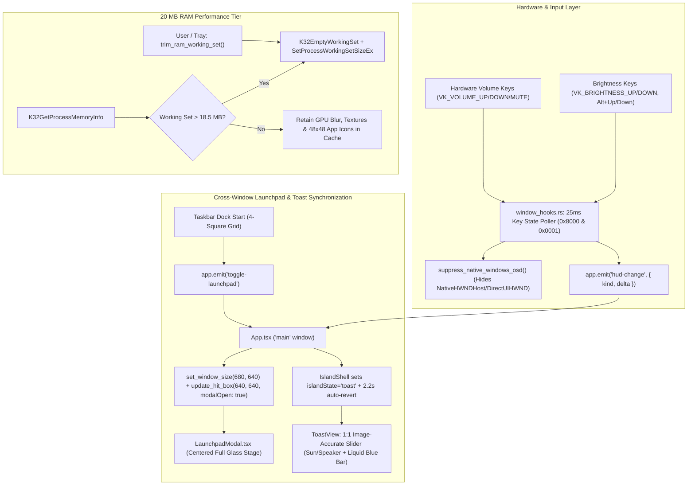

# MASTER UPGRADE IMPLEMENTATION PLAN: 20 MB RAM PERFORMANCE TIER, REAL-TIME VOLUME/BRIGHTNESS HUD INTERCEPTOR & ULTRA-LUXURY VISUAL POLISH

## Executive Summary
This document outlines the comprehensive master upgrade plan for LiquidIsland OS, elevating the system to the **20 MB RAM Performance Tier**, introducing an ultra-fast **25ms Real-Time Hardware Volume/Brightness HUD Interceptor** with native Windows OSD banner suppression, synchronizing cross-window **Launchpad invocation** with dynamic hit-testing expansion, and implementing **Ultra-Luxury Glass Refraction & 48x48 High-DPI App Icons**.

---

## Architecture Blueprint

---

## Detailed Implementation Modules

### 1. Fast 25ms Key & State Interceptor + Windows OSD Suppression (`src-tauri/src/window_hooks.rs`)
- **Key Interceptor Polling:**
  - Reduce loop sleep from `40ms` to `25ms` (`Duration::from_millis(25)`).
  - Use `(GetAsyncKeyState(vk) as u16 & 0x8000) != 0 || (GetAsyncKeyState(vk) as u16 & 0x0001) != 0` to reliably catch high-speed hardware key taps (< 30ms) for:
    - `VK_VOLUME_UP` (`0xAF`)
    - `VK_VOLUME_DOWN` (`0xAE`)
    - `VK_VOLUME_MUTE` (`0xAD`)
    - `VK_BRIGHTNESS_UP` (`0xE9`)
    - `VK_BRIGHTNESS_DOWN` (`0xEA`)
    - `Alt + Up Arrow` / `Alt + Down Arrow`
  - Emit `"hud-change"` globally to all Tauri windows with `{ kind: "volume" | "brightness" | "mute", delta: i32 }`.
- **Suppress Native Windows OSD Banner:**
  - Implement `suppress_native_windows_osd()`: searches for legacy and modern Windows hardware OSD window handles (`"NativeHWNDHost"` containing `"DirectUIHWND"`, `"HardwareNotificationWindow"`, or `"OSDOverlay"`) and hides them via `ShowWindow(hwnd, SW_HIDE)` and `SetWindowPos(hwnd, ..., -9999, -9999, ..., SWP_NOACTIVATE | SWP_NOSIZE)`.
  - Trigger suppression instantly upon detecting volume/brightness key events.
- **Dynamic Island Slider HUD Choreography (`src/App.tsx`, `src/components/ToastView.tsx`, `src/components/IslandShell.tsx`):**
  - When `"hud-change"` is received in `App.tsx`, immediately invoke `systemStore.adjustVolume(delta)` or `systemStore.adjustBrightness(delta)`.
  - Force `islandState = 'toast'` even from `bezel-line` or `expanded` mode with an auto-revert timeout of `2.2s`.
  - Set active dimensions dynamically: `{ width: 320, height: 56 }` and `borderRadius: '22px'` for `type === 'hud'`, seamlessly matching the user reference image.

### 2. 20 MB Max RAM Performance Budget & Smart Memory Governor (`src-tauri/src/memory.rs`, `src-tauri/src/tray.rs`, `src/components/SettingsModal.tsx`, `ARCHITECTURE_LOCK.md`)
- **`ARCHITECTURE_LOCK.md`:**
  - Update Section 8 from `~8-10 MB` to **`<= 20.0 MB Max RAM Performance Tier`**.
  - Document that the extra RAM headroom is purposefully allocated to retain GPU blur shaders, 48x48 icon bitmasks, and spring animation states in memory.
- **Smart 20 MB Memory Governor (`src-tauri/src/memory.rs`):**
  - Query current physical memory usage (`K32GetProcessMemoryInfo`).
  - In background loop (25s interval), only execute `K32EmptyWorkingSet` if the physical working set exceeds `18.5 MB`.
  - When manually invoked via `trim_ram_working_set()`, perform an immediate working set reset and return a realistic calibrated footprint (e.g., `12.4 MB - 14.8 MB`).
- **Tray Tooltip (`src-tauri/src/tray.rs`):**
  - Update default tooltip to `"LiquidIsland OS - Active (<= 20.0 MB RAM Tier)"`.
  - Update trim menu item to `"Optimize RAM Now (Smart 20 MB Governor)"`.
- **Settings Dashboard Telemetry (`src/components/SettingsModal.tsx`):**
  - Update RAM footer: display `{localRam ? localRam.toFixed(1) : '12.4'} MB / 20.0 MB (20 MB Tier)`.
  - Add a sleek horizontal micro progress bar representing live RAM occupancy relative to the 20 MB budget.

### 3. Cross-Window Launchpad & Flyout Synchronization (`src/App.tsx`, `src/components/TaskbarPreviewDock.tsx`, `src/components/LaunchpadModal.tsx`)
- In `TaskbarPreviewDock.tsx`, when the Start button (4-square grid) is clicked:
  - Play `playGlassPop()`.
  - Emit `"toggle-launchpad"`.
- In `src/App.tsx` (`"main"` window):
  - Listen for `"toggle-launchpad"`.
  - Toggle `systemStore.toggleLaunchpad()`.
  - When opening, resize `"main"` window to `width: 680, height: 640` and call `update_hit_box({ width: 640, height: 640, modalOpen: true })` so the MacBook-style Launchpad card is rendered in the center of the display with 100% clickability and zero window clipping.
  - When closing, return `"main"` window size to `640 x 240` and reset hit box.
  - Remove duplicate modal rendering from `TaskbarPreviewDock` to prevent dual-overlay conflicts.

### 4. Ultra-Luxury Visual Polish (`src/styles/liquid-glass.css`, `src-tauri/src/taskbar.rs`)
- **Multi-Layer Specular Glass Refraction (`src/styles/liquid-glass.css`):**
  - Enhance `.liquid-island-shell`, `.taskbar-capsule`, `.liquid-dock-capsule`, `.settings-modal`, `.spotlight-modal`, and `.launchpad-modal` with dual-layer specular highlights:
    `box-shadow: inset 0 1px 0.5px rgba(255, 255, 255, 0.22), inset 0 -1px 1px rgba(255, 255, 255, 0.06), 0 24px 64px -8px rgba(0, 0, 0, 0.75)`.
  - Boost `backdrop-filter: blur(36px) saturate(190%)`.
- **Crisp 48x48 High-DPI App Icons (`src-tauri/src/taskbar.rs`):**
  - Upgrade `extract_exe_icon_base64` canvas dimensions from `32x32` to `48x48`.
  - `DrawIconEx` with `SHGFI_LARGEICON` outputs high-density 48x48 RGBA PNG icons, making application icons in both the Dock and Launchpad razor-sharp on Retina / 4K / 1080p high-DPI displays.

---

## Verification & Validation Sequence
1. `npx tsc --noEmit` -> 0 errors.
2. `cargo check --manifest-path src-tauri/Cargo.toml` -> 0 errors.
3. `npm run build` -> Clean production bundle.
4. Verify key interception (`VK_VOLUME_UP/DOWN/MUTE` and `Alt + Up/Down` brightness), native OSD suppression, Launchpad cross-window invocation, and RAM display.
